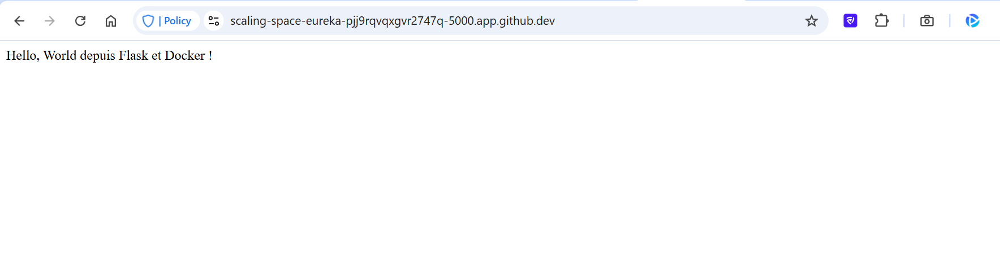
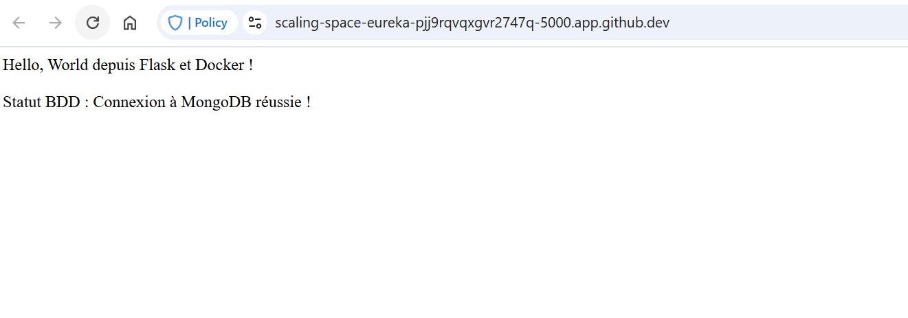

# tp-docker1

### Manipulation de base des conteneurs
- Vérification de la version de Docker
```
docker -- version
Docker version 29.9.2-2, build a82e528901260c8df6073311379eac65f92db204
```

- Liste des images disponible (J'ai déjà installer hello-world)
```
 $ docker images
                                                                                                        i Info →   U  In Use
IMAGE                ID             DISK USAGE   CONTENT SIZE   EXTRA
hello-world:latest   c567b231f656       25.9kB         9.49kB    U   
```

- Télécharger l'image "hello-world"
```
 $ docker pull hello-world
Using default tag: latest
latest: Pulling from library/hello-world
4f55086f7dd0: Pull complete 
d5e71e642bf5: Download complete 
Digest: sha256:c567b231f65614688711a75f31518a064258a51d442117a3e771a3a8fdba78ef
Status: Downloaded newer image for hello-world:latest
docker.io/library/hello-world:latest
```

-  Exécutez un conteneur à partir de l'image
```
$ docker run hello-world

Hello from Docker!
This message shows that your installation appears to be working correctly.

To generate this message, Docker took the following steps:
 1. The Docker client contacted the Docker daemon.
 2. The Docker daemon pulled the "hello-world" image from the Docker Hub.
    (amd64)
 3. The Docker daemon created a new container from that image which runs the
    executable that produces the output you are currently reading.
 4. The Docker daemon streamed that output to the Docker client, which sent it
    to your terminal.

To try something more ambitious, you can run an Ubuntu container with:
 $ docker run -it ubuntu bash

Share images, automate workflows, and more with a free Docker ID:
 https://hub.docker.com/

For more examples and ideas, visit:
 https://docs.docker.com/get-started/
```

-Liste des conteneurs en cours d'exécution
```
 $ docker ps
CONTAINER ID   IMAGE     COMMAND   CREATED   STATUS    PORTS     NAMES
```

-Liste des conteneurs actifs et stoppé
```
$ docker ps -a
CONTAINER ID   IMAGE         COMMAND    CREATED          STATUS                      PORTS     NAMES
533b30ec1228   hello-world   "/hello"   36 minutes ago   Exited (0) 36 minutes ago
```

- Commande pour supprimer un conteneur 
```
docker rm <ID_conteneur>
```

-Exemple en récupérant un ID :
```
$ docker ps -a
CONTAINER ID   IMAGE         COMMAND    CREATED        STATUS                    PORTS     NAMES
533b30ec1228   hello-world   "/hello"   32 hours ago   Exited (0) 32 hours ago             wonderful_tesla
@Selim-Hamza ➜ /workspaces/tp-docker1 (feature/exo3-manipulation-base) $ docker rm 533b30ec1228
533b30ec1228
```
- Commande permettent de supprimez une image 
```
docker rmi <ID_image>
```

-Exemple en récupérant id image: 

```
@Selim-Hamza ➜ /workspaces/tp-docker1 (feature/exo3-manipulation-base) $ docker images
                                                   i Info →   U  In Use
IMAGE                ID             DISK USAGE   CONTENT SIZE   EXTRA
hello-world:latest   c567b231f656       25.9kB         9.49kB
@Selim-Hamza ➜ /workspaces/tp-docker1 (feature/exo3-manipulation-base) $ docker rmi c567b231f656
Untagged: hello-world:latest
Deleted: sha256:c567b231f65614688711a75f31518a064258a51d442117a3e771a3a8fdba78ef
```

### Création d'un serveur web avec Docker

##### 1 Téléchargement de l'image Nginx et exécution d'un conteneur en tâche de fond sur le port 8080
```
docker pull nginx

docker run -d -p 8080:80 --name mon_nginx nginx
```

##### 2 Vérification avec `docker ps` et accès à la page web via le navigateur
```
$ docker ps
CONTAINER ID   IMAGE     COMMAND                  CREATED          STATUS          PORTS                                     NAMES
23e9efd7b763   nginx     "/docker-entrypoint.…"   15 minutes ago   Up 15 minutes   0.0.0.0:8080->80/tcp, [::]:8080->80/tcp   mon_nginx
```

##### 3 Arrêt (`docker stop`) et suppression (`docker rm`) du conteneur
```
 $ docker stop mon_nginx
mon_nginx
$ docker rm mon_nginx
mon_nginx
```

## Exercice 5: Déploiement d'une application Python Flask

#####  1 Création du fichier `app.py` (application Flask minimale)
```python
from flask import Flask

app = Flask(__name__)

@app.route('/')
def hello_world():
    return 'Hello, World depuis Flask et Docker !'

if __name__ == '__main__':
    app.run(host='0.0.0.0', port=5000)
```

##### 2 Écriture du `Dockerfile`
```Dockerfile
# 1. Image de base légère (le système d'exploitation avec Python préinstallé)
FROM python:3.10-slim

# 2. Définition du répertoire de travail dans le conteneur
WORKDIR /app

# 3. Copie des fichiers locaux vers le conteneur
COPY app.py .

# 4. Installation de la dépendance Flask
RUN pip install flask

# 5. Commande d'exécution au démarrage du conteneur
CMD ["python", "app.py"]
```


#####  3 Construction de l'image avec 
`docker build -t mon_flask .`

#####  4 Exécution et test avec
 `docker run -d -p 5000:5000 mon_flask`

 - Rendu de l'application : 
 

## Exercice 6: Utilisation de docker compose

##### 1 Ajout de la connexion MongoDB dans `app.py`
```python
from flask import Flask
from pymongo import MongoClient

app = Flask(__name__)

# Le nom d'hôte 'mongo' fera référence au service défini dans docker-compose
client = MongoClient('mongodb://mongo:27017/')

@app.route('/')
def hello_world():
    try:
        # Test de la connexion à la base de données
        client.admin.command('ping')
        status = "Connexion à MongoDB réussie !"
    except Exception as e:
        status = f"Échec de connexion : {e}"
    
    return f"Hello, World depuis Flask et Docker ! <br><br> Statut BDD : {status}"

if __name__ == '__main__':
    app.run(host='0.0.0.0', port=5000)
```

##### 2 Modification la ligne d'installation pour inclure le pilote MongoDB dans `Dockerfile`
`RUN pip install flask pymongo`

##### 3 Création du fichier `docker-compose.yml` avec les deux conteneurs (on met une version stable de mongo pas latest)
```yml
version: '3.8'
services:
  web:
    build: .
    ports:
      - "5000:5000"
    depends_on:
      - mongo
  
  mongo:
    image: mongo:4.4
    ports:
      - "27017:27017"
```

- Rendue de l'app:


##### 4 Nettoyer l'environnement
`docker compose down`
